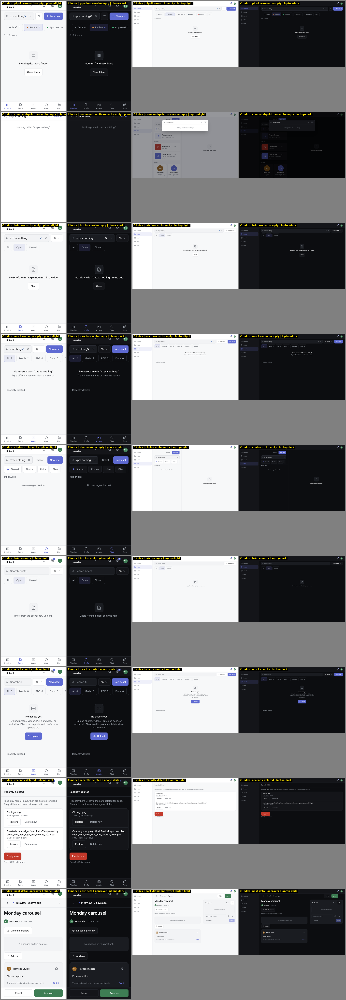
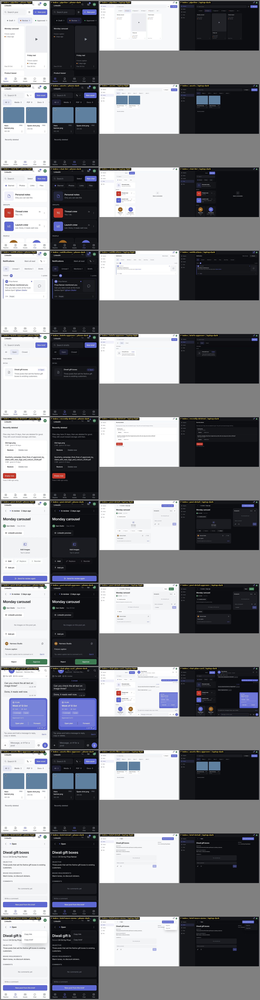

# Consistency audit screenshots, 24 Oct 2026

Audit of commit c84e6ee. Screens regenerated at origin/main in Chromium via the e2e harness and its fixtures (iPhone 13 viewport and 1280x800, light and dark).
Each image has 4 columns: phone-light, phone-dark, laptop-light, laptop-dark. One row per screen variant. Phone cells are 390 wide, laptop cells 640 wide.

## Findings

| ID    | Title                                                                                                                             | Screens                                                                                                          | Image                  |
| ----- | --------------------------------------------------------------------------------------------------------------------------------- | ---------------------------------------------------------------------------------------------------------------- | ---------------------- |
| A1-01 | only "New post" has a plus icon; New asset / chat / brief / plan have none                                                        | pipeline, assets, chat-list, briefs-approver, plan-tab                                                           | [A1-01.png](A1-01.png) |
| A1-03 | empty-state create vs header create                                                                                               | assets-empty, briefs-empty                                                                                       | [A1-03.png](A1-03.png) |
| A1-06 | create gating                                                                                                                     | assets-approver, assets-files-approver, pipeline-approver                                                        | [A1-06.png](A1-06.png) |
| A3-01 | Cancel variant                                                                                                                    | create-brief-sheet-approver, confirm-dialog-discard, on-behalf-confirm                                           | [A3-01.png](A3-01.png) |
| A3-03 | approve-confirm dismiss                                                                                                           | approve-confirm-approver, on-behalf-confirm                                                                      | [A3-03.png](A3-03.png) |
| A4-01 | delete: undo only / confirm only / both / neither, across entities                                                                | confirm-dialog-delete, post-more-menu                                                                            | [A4-01.png](A4-01.png) |
| A6-01 | the ⋯ menu uses 6 different containers                                                                                            | post-more-menu, brief-more-menu, asset-more-menu, chat-actions-menu, message-action-menu                         | [A6-01.png](A6-01.png) |
| B1-01 | list page title                                                                                                                   | pipeline, plan-tab, notifications, briefs-approver, help                                                         | [B1-01.png](B1-01.png) |
| B1-03 | counts                                                                                                                            | pipeline, briefs-approver, assets, notifications                                                                 | [B1-03.png](B1-03.png) |
| B1-04 | detail header bar                                                                                                                 | pipeline, assets, notifications, help                                                                            | [B1-04.png](B1-04.png) |
| B1-05 | ⋯ trigger                                                                                                                         | plan-screen, post-detail, chat-thread, brief-detail, plan-item                                                   | [B1-05.png](B1-05.png) |
| B2-01 | app chrome on detail screens (phone)                                                                                              | post-detail, brief-detail, chat-thread                                                                           | [B2-01.png](B2-01.png) |
| B2-03 | close X on the left vs right, 18/20/22 px, or a "Cancel" text, on create and edit surfaces                                        | create-post-sheet, create-brief-sheet-approver, new-chat-sheet, plan-screen                                      | [B2-03.png](B2-03.png) |
| B4-01 | search placeholder                                                                                                                | pipeline, briefs-approver, assets, chat-list, help, command-palette                                              | [B4-01.png](B4-01.png) |
| B5-01 | filter chips                                                                                                                      | pipeline, briefs-approver, assets, chat-list, notifications, help                                                | [B5-01.png](B5-01.png) |
| C1-01 | banned "Nothing" wording (22 Oct rule)                                                                                            | pipeline-search-empty, command-palette-search-empty                                                              | [C1-01.png](C1-01.png) |
| C1-02 | nine no-results wordings; Clear button on only 2 of them                                                                          | pipeline-search-empty, briefs-search-empty, assets-search-empty, chat-search-empty, command-palette-search-empty | [C1-02.png](C1-02.png) |
| C1-03 | EmptyState component vs hand-written                                                                                              | briefs-empty, assets-empty                                                                                       | [C1-03.png](C1-03.png) |
| C1-04 | missing empty state (renders null)                                                                                                | recently-deleted                                                                                                 | [C1-04.png](C1-04.png) |
| D1-01 | format label                                                                                                                      | post-detail, create-post-sheet, chat-plan-card                                                                   | [D1-01.png](D1-01.png) |
| D2-02 | asset vs file                                                                                                                     | assets, asset-more-menu, assets-search-empty, recently-deleted                                                   | [D2-02.png](D2-02.png) |
| D2-05 | notifications vs activity                                                                                                         | notifications, help                                                                                              | [D2-05.png](D2-05.png) |
| D2-06 | chat list name                                                                                                                    | chat-list, chat-search-empty, new-chat-sheet                                                                     | [D2-06.png](D2-06.png) |
| D5-03 | workspace name                                                                                                                    | settings-workspace, pipeline                                                                                     | [D5-03.png](D5-03.png) |
| E3-01 | the same person or group avatar changes size and shape on every chat surface                                                      | chat-list, chat-thread, chat-thread-group, chat-search-empty                                                     | [E3-01.png](E3-01.png) |
| E5-01 | unread count                                                                                                                      | chat-list, pipeline, notifications                                                                               | [E5-01.png](E5-01.png) |
| F5-01 | agency in chat PostSheet loses Reject, Park, Send for review and the approver picker, all of which Post detail and Pipeline allow | post-detail-approver, chat-plan-card, post-detail                                                                | [F5-01.png](F5-01.png) |
| F6-02 | Post decision buttons sit in 3 places by width; Brief action in 2                                                                 | post-detail-approver, post-detail, brief-detail                                                                  | [F6-02.png](F6-02.png) |

## Category index

### A Actions & buttons

27 screens: pipeline, assets, chat-list, briefs-approver, plan-tab, assets-empty, briefs-empty, plan-screen, assets-approver, assets-files-approver, pipeline-approver, confirm-dialog-delete, post-detail, chat-thread, create-brief-sheet-approver, confirm-dialog-discard, on-behalf-confirm, approve-confirm-approver, pipeline-search-empty, briefs-search-empty, post-detail-approver, chat-plan-card, post-more-menu, brief-more-menu, asset-more-menu, chat-actions-menu, message-action-menu

### B Headers/nav/layout

20 screens: pipeline, plan-tab, notifications, briefs-approver, help, assets, post-detail, brief-detail, chat-thread, plan-screen, plan-item, post-more-menu, brief-more-menu, create-post-sheet, create-brief-sheet-approver, new-chat-sheet, confirm-dialog-discard, on-behalf-confirm, chat-list, command-palette

### C States

9 screens: pipeline-search-empty, command-palette-search-empty, briefs-search-empty, assets-search-empty, chat-search-empty, briefs-empty, assets-empty, recently-deleted, post-detail-approver

### D Content & copy

18 screens: post-detail, create-post-sheet, chat-plan-card, plan-tab, message-action-menu, briefs-empty, assets, asset-more-menu, assets-search-empty, recently-deleted, notifications, help, chat-list, chat-search-empty, new-chat-sheet, settings-workspace, chat-thread, pipeline

### E Icons & media

15 screens: post-more-menu, message-action-menu, post-detail-approver, chat-thread, post-detail, asset-more-menu, brief-more-menu, chat-actions-menu, pipeline, chat-list, chat-thread-group, chat-search-empty, chat-plan-card, assets, notifications

### F Behaviour

12 screens: pipeline, assets, chat-list, notifications, briefs-approver, recently-deleted, post-detail, post-detail-approver, chat-plan-card, assets-files-approver, brief-detail, brief-more-menu

## Skipped screens

- create-brief-sheet (creator role): the New brief button is approver-only, so the creator sheet cannot be reached with existing fixtures. The approver sheet (create-brief-sheet-approver) is captured.

46 of the 47 attempted screens captured in all 4 projects (184 raw shots). Not covered by the harness: load-error states, loading states, motion, long-press timing.
